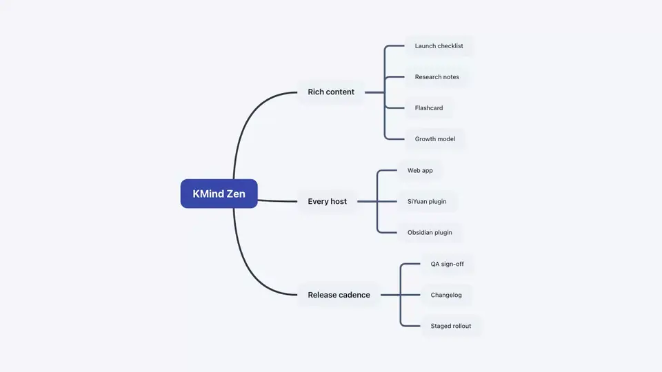
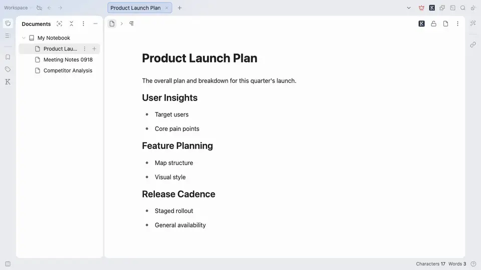
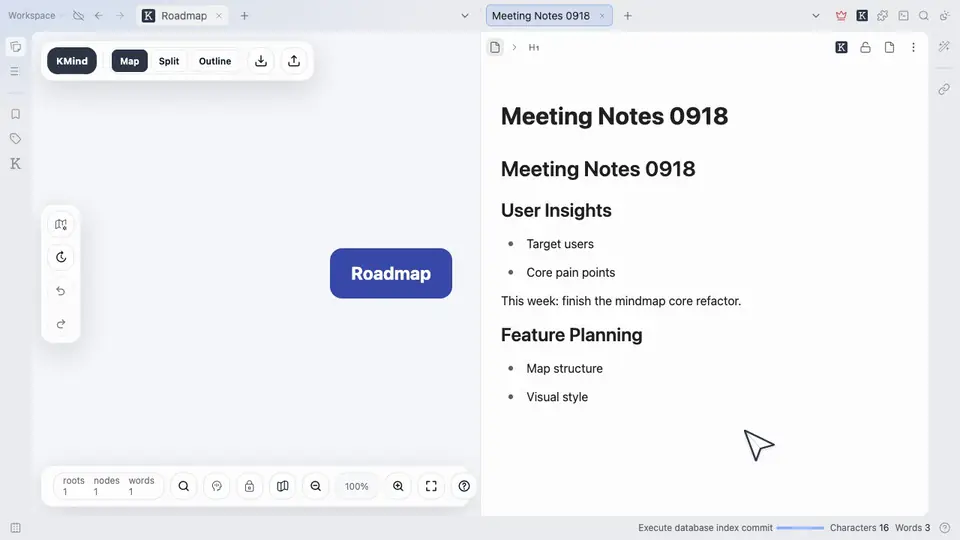
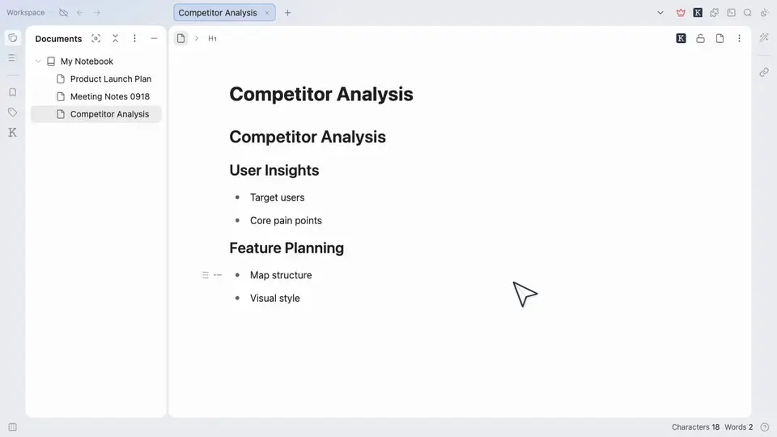
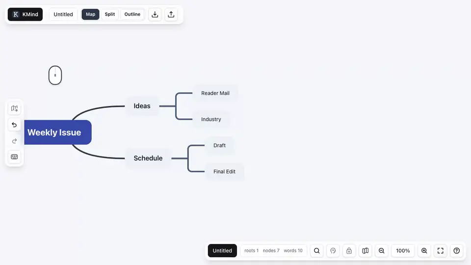
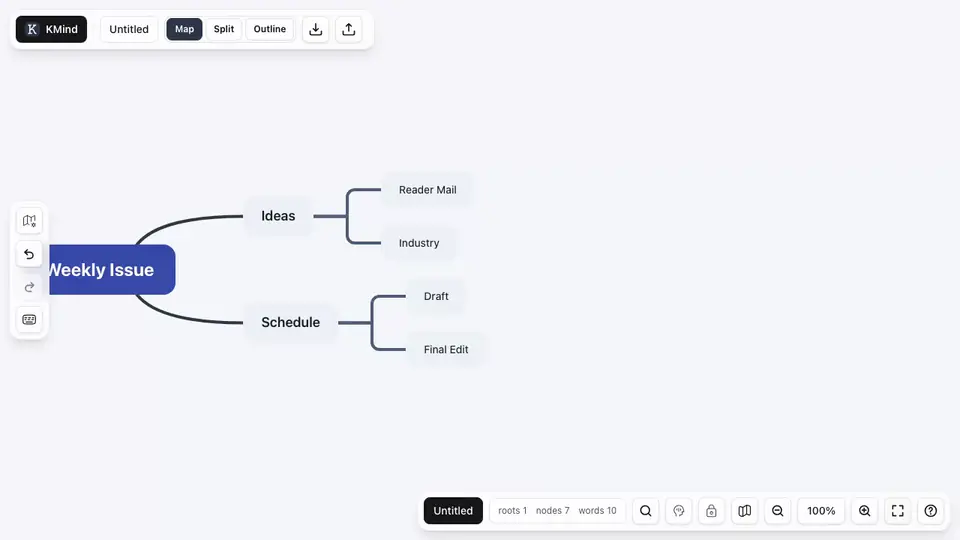
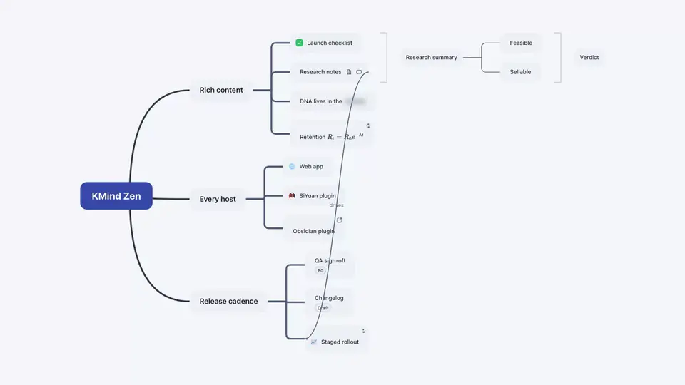
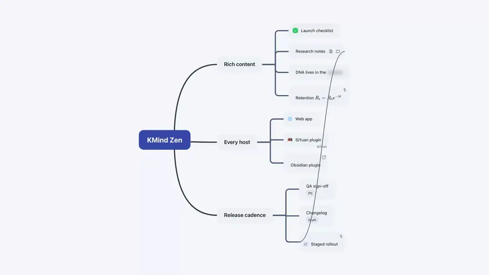

# KMind Zen for SiYuan (Public Beta)

[中文说明](https://github.com/suka233/siyuan-kmind-zen/blob/master/README_zh_CN.md)

KMind Zen is a next-generation professional mind mapping tool that started in SiYuan and is now expanding into a broader ecosystem. Website: https://kmind.app

Unlike KMind2, KMind Zen was rebuilt from the ground up, with a redesigned core, interface, and interaction model for greater flexibility and room to grow. Today, KMind Zen is available as a SiYuan plugin, an Obsidian plugin, a web app, a standalone Mac app, and an OpenClaw Skill.

**Version:** `0.46.0` · [Changelog](https://github.com/suka233/siyuan-kmind-zen/blob/master/CHANGELOG.md) · [Release notes on kmind.app](https://kmind.app/en/changelog/siyuan)

## See It in Action

### Built for SiYuan

Turn a SiYuan document into a map view: preview the full block tree or organize it by headings, then create an editable child mind map from the result.

Drag a SiYuan block onto the canvas to create a block card. Text typed in the card or in the original block shows up on the other side.

Insert a block map from the slash menu. It renders as a native image preview inside the document and reopens for editing from the image action button or the context menu.

### One node, many kinds of content

To-dos, notes, comments, icons, tags, external and internal links, cloze deletions, LaTeX formulas, relationship lines, and summaries of summaries all live on the same map, and each of them is edited in place.

### Edit the same map as a canvas or an outline

Switch between Map, Split, and Outline views from the top bar. In Split view the canvas and the outline sit side by side and stay in sync.

Drag a canvas node onto an outline row to move it there, or drag an outline row back onto a canvas node to make it a child. Structure changes show up on both sides immediately.

### Themes that follow light and dark mode

Every official theme ships with a light and a dark variant, so the map follows SiYuan's appearance without a manual toggle. A local theme designer and `.kmind-theme.json` import/export take it further.

### Layouts for different kinds of thinking

Logic chart, two-sided mind map, timeline, and fishbone. Switch the layout of an existing map without rebuilding it.

Step-by-step tutorials with more clips: [SiYuan plugin tutorials](https://kmind.app/en/tutorials/siyuan-plugin-features) and the full [tutorial index](https://kmind.app/en/tutorials).

## Features

- Every KMind Zen host runs on the same core. A single KMind Zen source file can move smoothly between SiYuan, Obsidian, the web app, and the standalone desktop app. You can also use the KMind Zen Skill with AI tools to turn source material into editable mind maps offline. One practical workflow is converting lecture or meeting recordings into KMind Zen documents that you can refine and archive later.
- A purpose-built `.kmindz.svg` source format. It contains the full editable source document while still being a valid SVG image, so you can preview the map without opening it first.
- Portable node copy and cut across maps and supported KMind Zen hosts, including referenced images and other node assets.
- Smart themes with both light and dark variants across the official theme set, switching automatically with no manual theme toggle required.
- A local theme designer and theme library, with import/export support for `.kmind-theme.json` sharing packages.
- Polished and more reliable import/export, including `.md` / `.opml` import and export, `.txt` import, `.mm` import/export, `.xmind` export, SVG / PNG export, and copy-as-image styles.
- Direct node width resizing from the canvas.
- True in-place node editing that keeps the editor inside the node body.
- Outline and Split modes for editing the same mind map as both a spatial map and a continuous outline.
- Split mode can move nodes in both directions between the map and outline.
- Advanced relationship line editing, including straight, orthogonal, rounded orthogonal, and brace styles, smarter editor avoidance, dashed and dotted styles, color settings, project-level defaults, and summary relationship lines.
- Unlimited summary nesting, so summaries can contain their own summaries at any depth.
- Flexible cloze support for both nodes and notes, designed for memorization and review.
- An improved formula editor that can be opened quickly from the slash menu.
- Enhanced global search that goes beyond node text and also covers notes, comments, and more.
- Bidirectional links between nodes.
- Node comments that are distinct from notes and can be reviewed in chronological order, making it easier to revisit the thinking process behind a map.
- Refined drag-and-drop interactions, including bulk dragging for selected node groups.
- Right-click expansion and collapse controls for quickly focusing large maps.
- Configurable canvas drag and wheel behavior for users who prefer blank-space panning, blank-space marquee selection, or `Ctrl/Cmd` wheel zoom.
- Improved hyperlink support, including multiple links per node and custom icons for each link.
- A more polished Zen mode and read-only experience, with the current state clearly visible and easy to exit from the top-right corner.
- A mobile experience optimized as much as possible, with a dedicated UI for mobile devices. More feedback is still needed to keep improving it.
- Configurable KMind Zen shortcuts that stay scoped to the active mind map experience.
- Core editing capabilities such as rich text nodes, rich text notes, multi-root maps, node images with quick resizing and positioning, TODOs, icons, notes, tags, format painter, and relationship lines.

## Built for SiYuan

- Create KMind Zen mind maps directly from the SiYuan document tree, with native support for SiYuan tags, links, and related concepts.
- Turn ordinary SiYuan documents into map views, either as a read-only full block tree preview or as a heading outline organizer, then create an editable child mind map from the result.
- Split a long SiYuan document into a hierarchy of subdocuments directly from Heading Outline, then continue organizing the result in MOC mode automatically.
- Use MOC document-tree maps to view a SiYuan document tree as a mind map and write organizing actions such as create, rename, move, reorder, and delete back to SiYuan.
- Embed read-only mirror blocks in normal SiYuan documents by copying a whole map or a selected node from KMind Zen and pasting it into the editor.
- Insert block maps into normal SiYuan documents from the slash menu. The note shows a native image preview, the image action button opens the map for editing, and the preview clarity can be adjusted in global settings.
- Copy PDF annotations from SiYuan's PDF reader and paste them into a map as clickable PDF links.
- Drag documents from the SiYuan document tree onto blank canvas to create document cards, or onto existing nodes to quickly add SiYuan document links. Hold `Alt/Option` while dropping onto a node to create a document-card child node. Document cards are special nodes that still support child nodes, relationship lines, and other map operations. They default to preview mode, where preview content refreshes at a lower frequency for performance. You can switch to live mode at any time.
- Drag KMind mindmap documents from the SiYuan document tree into a map as links: blank canvas creates a regular link node, while regular nodes receive SiYuan document links.
- Drag SiYuan blocks onto blank canvas to create block cards, or onto existing nodes to quickly add SiYuan block links. Hold `Alt/Option` while dropping onto a node to create a block-card child node. Block cards are also special nodes that can have child nodes, relationship lines, and more.
- Paste copied `siyuan://blocks/<id>` URLs or Markdown SiYuan block links into a map. Blank-canvas paste creates readable link nodes, and pasting onto an empty node fills its text from the referenced SiYuan block while preserving existing text on non-empty nodes.
- SiYuan Agent can create dock maps and operate open document-tree maps and dock maps.
- Create mind maps from the SiYuan dock.
- Thanks to SiYuan's block-based architecture, both entire mind maps and individual map nodes can be copied as permanent links. You can paste those links into external apps, and clicking them will open SiYuan, load the target map, and jump straight to the specific node.

## Roadmap

- [ ] AI features
- [ ] Submaps
- [ ] Flowcharts
- [ ] Handwriting
- [ ] Collaboration

## Limitations

- KMind Zen does not yet include every KMind2 feature. The remaining gaps are a few advanced legacy workflows. These capabilities will be redesigned in the KMind Zen style and released gradually.
- Document-tree mind maps, SiYuan doc-to-map, MOC, and new mirror-block creation require Pro. Existing mirror blocks remain readable and refreshable. Dock maps remain free.
- Full block tree document maps are read-only previews. When complex blocks are created as an editable KMind Zen map, entering edit mode converts them into the editable forms currently supported by KMind Zen, so preview formatting may not be preserved exactly.
- If you use SiYuan sync, do not edit the same mind map on multiple devices at the same time.
- When an existing map is first edited and saved in version 0.39.0 or later, its file version may be upgraded automatically. Do not continue editing or saving that map with an older KMind Zen plugin, as this may cause save failures or discard data that the older version does not understand.

## QA

Q: What's the difference between KMind Zen and KMind2?

A: KMind Zen is built on a brand-new core, with a more polished look, a cleaner design, and a smoother, more intuitive experience. The magic is in the details, so dive in and try it out.

Q: Do I need to pay again?

A: No. During the campaign period, which ends on 2026-05-20, users who previously purchased a KMind2 lifetime or annual subscription can upgrade to KMind Zen for free. For the SiYuan edition, follow the `KMind 思维导图` WeChat official account and send your old activation code, such as `kmind-xxxx`, to receive a KMind Zen lifetime or annual activation code. Global users can contact `kmind_app@outlook.com` by email for upgrade support.

Q: If I only want KMind Zen, is there an early-bird discount?

A: Yes. Enter the early-bird promo code `HELLO-KMIND-ZEN` at checkout to pay 67% of the price. This code expires after 2026-05-20.

Q: Will KMind2 stop getting updates completely?

A: KMind2's feature set is already quite mature. It is also built on the external [mind-map](https://github.com/wanglin2/mind-map) library. Although that library is MIT-licensed, extending KMind2 to more hosts such as an Obsidian plugin or a standalone desktop client would inevitably create conflicts with the original author's product direction. Because of that, all new features will be developed on KMind Zen's self-developed core. KMind2 is entering maintenance mode and will remain stable and usable. If future SiYuan updates make KMind2 unavailable, fixes will be provided promptly.

Q: Does KMind Zen still offer an education discount?

A: Yes. The policy is the same as KMind2. Send a non-failing transcript from your school's academic email account to `kmind_app@outlook.com`, and you can follow the instructions to receive a free annual KMind Zen membership.
